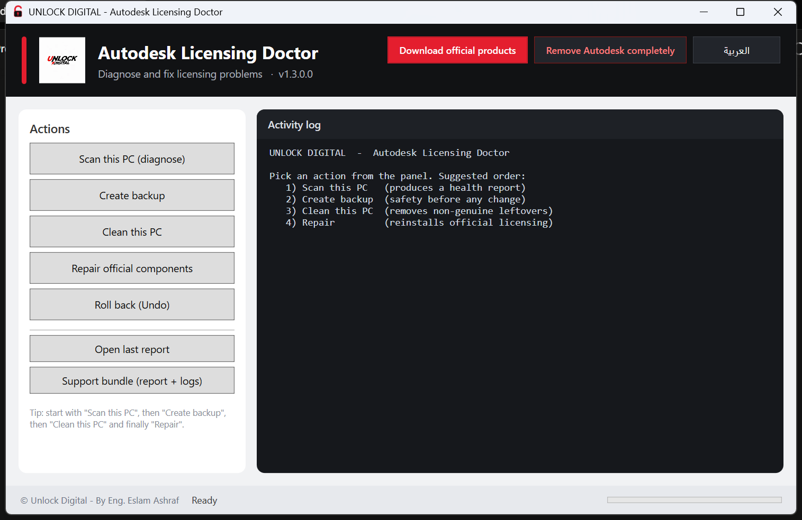
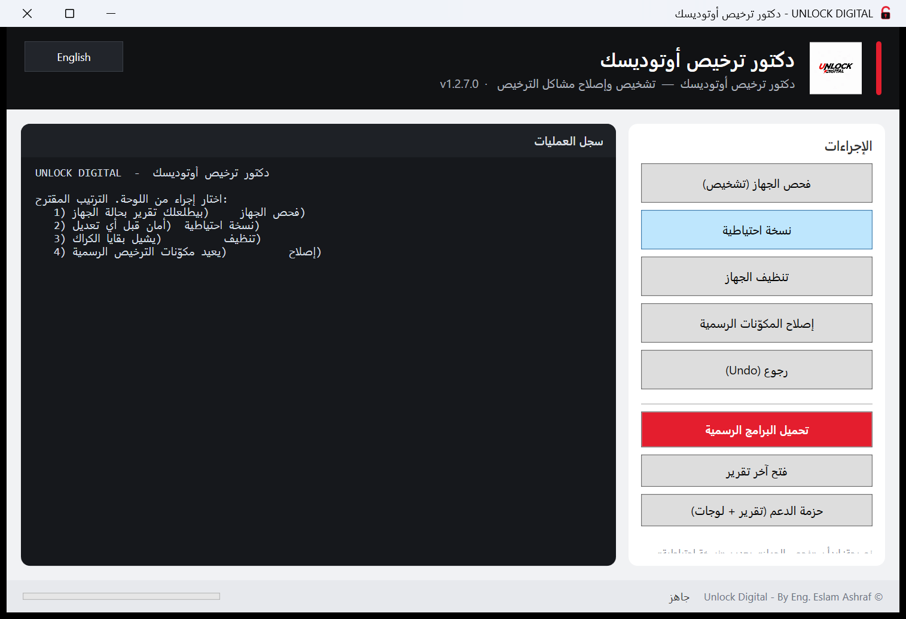

# Autodesk Licensing Doctor

[](https://github.com/Es1amAshraf/autodesk-licensing-doctor/actions/workflows/ci.yml)
[](https://github.com/Es1amAshraf/autodesk-licensing-doctor/releases/latest)
[](LICENSE)


**UNLOCK DIGITAL** — By Eng. Eslam Ashraf

A portable Windows toolkit for Autodesk resellers and IT pros that **removes
leftovers of non-genuine Autodesk patches** and **restores healthy official
single-user subscription licensing** (`ADLS` + `AdSSO`), so genuine products
activate and run normally again. It also carries a **full-removal option** that
takes every Autodesk trace off a machine for a clean re-install.

Windows 10 / 11 · GUI in **Arabic + English** · no installation required.

---

## Download

| What | Link |
|------|------|
| **Installer (recommended)** — `UNLOCK-DIGITAL-AdskDoctor-Setup-1.3.3.exe` (2.12 MB) | [direct download](https://github.com/Es1amAshraf/autodesk-licensing-doctor/releases/download/v1.3.3/UNLOCK-DIGITAL-AdskDoctor-Setup-1.3.3.exe) |
| Portable `.zip` (no install) and full source | [releases page](https://github.com/Es1amAshraf/autodesk-licensing-doctor/releases/latest) |
| Always the newest release | <https://github.com/Es1amAshraf/autodesk-licensing-doctor/releases/latest> |

SHA256 of the files above (also in `SHA256SUMS.txt` on the release page):

```text
7E4E89278BBC0BB400020C678DEEF78627985FC06792E7E91CC78C38DD578B80  UNLOCK-DIGITAL-AdskDoctor-Setup-1.3.3.exe
4407B751968B1710223305F0A30C9ECB0934952300826E4A8921A76C4E03300C  AdskDoctor-v1.3.3-Portable.zip
D5309A4FA574CDE0F84FB68D35F1655A60F314357D5667D718AA5686967C2D5E  AdskDoctor-v1.3.3-Project.zip
```

See [Verify your download](#verify-your-download).

The installer adds a desktop shortcut and an uninstaller, and is branded with the
UNLOCK DIGITAL logo. See [Quick start](#quick-start) below.

---

## Screenshots

The window in English and in Arabic (the language button in the header switches
between them at runtime):





---

## Legal and ethical notice

This project exists to **clean up** machines that were previously patched with
cracked software and to **restore the official Autodesk licensing stack**.

* It **does not** include, generate, distribute or bypass any license.
* It **does not** patch or crack Autodesk products.
* A valid **Autodesk subscription / license** is still required to use Autodesk
  software.
* It removes non-genuine leftovers and repairs official components so that a
  legitimate sign-in (single-user) subscription works.

You are responsible for complying with the Autodesk Terms of Service and all
applicable laws in your jurisdiction.

---

## How it works — 5 phases

| Phase | Purpose | Changes system? |
|-------|---------|-----------------|
| **1** | Deep read-only diagnostic (~19 checks) | no |
| **2** | Layered backup + generated `UNDO.ps1` | writes backup only |
| **3** | Safe cleanup of leftovers from non-genuine patches | **preview by default** — needs `-Apply` |
| **4** | Repair / reinstall official licensing components (ADLS, AdSSO) | **preview by default** — needs `-Apply` |
| **5** | Full removal — every Autodesk trace (products, licensing, registry, crack roots) off the machine | **preview by default** — needs `-Apply` |

**Safety model:** backup always runs first, cleanup/repair/removal do
**nothing** until you explicitly pass `-Apply`, and every cleanup change is
reversible through the backup's `UNDO.ps1`. The full removal (Phase 5) backs up
first as well, but it means what it says — the products have to be installed
fresh afterwards.

---

## Which problem does it fix?

| What the customer sees | What the toolkit checks / does |
|------------------------|-------------------------------|
| **"Licensing error — An error occurred"** (AutoCAD/Revit 2020+) | Verifies the whole sign-in licensing stack (ADLS build, service state, licensing agent, identity/SSO component), flags a stale or half-updated licensing service, resets leftover licence caches and reinstalls the official components in the Repair phase. |
| **"Connection Lost to Autodesk Desktop Licensing Service"** | ADLS presence, state, start-up mode and the signature of its service binary; an old or replaced build is reported and the Repair phase installs the official one. |
| **Sign-in window never opens / sign-in fails** | AdSSO + identity component, **the Edge WebView2 runtime that renders the sign-in window**, `hosts` hijacks, firewall blocks, WinHTTP proxy, DNS and connectivity to `accounts.autodesk.com`. The product fails with a licensing error *before* the sign-in page when WebView2 is missing. |
| **Ask for a serial number / activation screen** | Legacy ADLM licence cache (`ProductInformation.pit`, `ProgramData\FLEXnet`) left by a non-genuine activation — the Cleanup phase resets it so the product asks for a normal sign-in again. |
| **Product opens on the license-server screen although the customer has a sign-in subscription** | Its registered license *method* is wrong (left over from a network/standalone setup). The GUI **License mode** panel (or `LicenseMode.ps1`) lists what the licensing service has registered and switches that product back to **single-user (sign-in)** — or to Network / Standalone / Reset — through the official `AdskLicensingInstHelper` (`list` / `change`). |
| **"The license manager is not functioning"** | Leftover **Network License Manager** (service pointing at deleted binaries) — reported as a stale leftover and removed by Cleanup (`-KeepNLM` keeps it). |
| **Product does not start at all, no error** | **IFEO execution blockers** — a `Debugger` value squeezing an Autodesk executable. Cleanup removes them; the Repair phase cannot succeed while one is in place. |
| **Error 1603 / "unable to install"** | Orphaned uninstall entries, VC++ 2015–2022 runtime, TEMP, ODIS installer cache, antivirus / Controlled Folder Access. |
| **Activation refused, clock errors** | Windows Time service and system clock drift against internet time. |
| **"I don't want a repair — wipe everything and start clean"** | The **Remove Autodesk completely** button (Phase 5) uninstalls the products the official way, then removes every folder, service, task, registry key and crack root, and verifies the machine is clean. |

The diagnostic always states a verdict and groups the problems by area, so a
report with hundreds of findings still reads as a short list of things to do.

---

## Quick start

### Installer (recommended) — single `.exe`

1. Download **`UNLOCK-DIGITAL-AdskDoctor-Setup-<version>.exe`** from the
   [Releases](../../releases) page.
2. Run it and accept the UAC prompt — it installs to
   `%ProgramFiles%\UNLOCK DIGITAL\AdskDoctor` and creates Desktop / Start Menu
   shortcuts, all branded with the **UNLOCK DIGITAL** logo.
3. Launch **Autodesk Licensing Doctor** from the shortcut.
4. Uninstall any time from **Settings → Apps** (or the Start Menu).

### Portable

1. Download `AdskDoctor-v<version>-Portable.zip` from Releases and extract it.
2. Run **`UNLOCK-DIGITAL-AdskDoctor.exe`** (accept the UAC prompt) → bilingual GUI opens.
3. Keep all files in the same folder — the app calls the `.ps1` scripts sitting
   next to the `.exe`.

Two extra buttons in the top bar, next to the language toggle:

* **Download official products** — opens the official Autodesk download page.
* **Remove Autodesk completely** — Phase 5: takes every Autodesk trace off the
  machine. It asks for confirmation twice and runs a backup first.

In the left panel, **License mode** fills itself with the products the licensing
service has registered: pick a product, pick the license type (**single-user
sign-in / network / standalone / reset**) and press **Switch license type**.
It previews in the log, asks a confirmation, and only then applies — this is
the fix when a product keeps opening on the license-server screen although the
customer has a sign-in subscription. (Autodesk's own "Desktop Licensing Support
Tool" used to do this; it is no longer distributed, and this uses the same
official helper underneath.)

---

## Command line

The engine is scriptable too (all scripts run read-only/preview unless `-Apply`):

```powershell
# Phase 1 — diagnostic (writes report.html and opens it)
powershell -ExecutionPolicy Bypass -File .\AdskDoctor.ps1 -Html -Export report.html

# Phase 1 — diagnostic + support bundle (report + licensing logs + system info
# collected into one zip, the thing to send with a support request)
powershell -ExecutionPolicy Bypass -File .\AdskDoctor.ps1 -Html -Export report.html -Bundle

# Phase 2 — layered backup (restore point + .reg exports + file copies + UNDO.ps1)
powershell -ExecutionPolicy Bypass -File .\Backup.ps1

# Phase 3 — cleanup (preview first!)
powershell -ExecutionPolicy Bypass -File .\Clean.ps1
powershell -ExecutionPolicy Bypass -File .\Clean.ps1 -Apply

# Phase 4 — repair / reinstall official components
powershell -ExecutionPolicy Bypass -File .\Repair.ps1
powershell -ExecutionPolicy Bypass -File .\Repair.ps1 -Apply

# Phase 4 — with the official installers you have (point it at a folder, or pass
# each file). WebView2 is a Microsoft component, so it has its own switch.
powershell -ExecutionPolicy Bypass -File .\Repair.ps1 -Apply -InstallerDir "D:\Autodesk-Installers"
powershell -ExecutionPolicy Bypass -File .\Repair.ps1 -Apply `
    -AdlsInstaller "C:\...\Autodesk_Licensing_Service.exe" `
    -WebView2Installer "C:\...\MicrosoftEdgeWebview2Setup.exe"

# Phase 5 — full removal (preview first!): every Autodesk trace off the machine
powershell -ExecutionPolicy Bypass -File .\Purge.ps1
powershell -ExecutionPolicy Bypass -File .\Purge.ps1 -Apply

# License mode — list what the licensing service has registered…
powershell -ExecutionPolicy Bypass -File .\LicenseMode.ps1 -List
powershell -ExecutionPolicy Bypass -File .\LicenseMode.ps1 -List -Json   # for the GUI

# …and switch one product's license type (preview first!). USER = single-user
# sign-in subscription; NETWORK = a license server; STANDALONE = legacy serial;
# RESET only removes the stored choice, so the product asks again at next launch.
powershell -ExecutionPolicy Bypass -File .\LicenseMode.ps1 -ProductKey 001Q1 -ProductVersion 2025.0.0.F -LicenseType USER
powershell -ExecutionPolicy Bypass -File .\LicenseMode.ps1 -ProductKey 001Q1 -ProductVersion 2025.0.0.F -LicenseType USER -Apply

# back to a license server (one address = single; two or three addresses without
# -LicServerType are treated as a redundant pool; a port goes in as port@host)
powershell -ExecutionPolicy Bypass -File .\LicenseMode.ps1 -ProductKey 829P1 -ProductVersion 2024.0.0.F -LicenseType NETWORK -LicServers "27000@licsrv01" -Apply
powershell -ExecutionPolicy Bypass -File .\LicenseMode.ps1 -ProductKey 829P1 -ProductVersion 2024.0.0.F -LicenseType RESET -Apply
```

`Repair.ps1` **never downloads anything.** It installs the official components
you give it, and when one is missing with no installer supplied it prints where
to get the official one instead of inventing a source. `Purge.ps1` never
downloads anything either — it only removes. `LicenseMode.ps1` never downloads
anything either — it drives the official helper that already ships with the
installed products.

---

## Support bundle

A licensing failure is written to a log before it reaches the screen, and the
log names the exact cause — but asking a customer to find it never works. The
diagnostic collects them for you:

```powershell
.\AdskDoctor.ps1 -Html -Export report.html -Bundle
# -> AdskDoctor-Support-<PC>-<date>.zip
#      report.html        the full report
#      logs\              the newest licensing logs (agent, ADLS, LGS, sign-in)
#      system-info.txt    OS, products, summary, verdict
```

In the app it is the **Support bundle** button; the folder opens when it is done.
The report itself also prints the failure lines it finds in the newest logs
(email addresses masked), so the reason is often visible without the zip.

---

## What Phase 1 checks (read-only)

System readiness (admin, restore point, pending reboot, **pending file
renames**) · clock / time sync ("Clock Error") · installer health
("Error 1603") · `hosts` hijacking · firewall blocks · Autodesk/FlexNet
services (including services that point at deleted binaries) · **IFEO execution
blockers** that stop Autodesk executables from starting · deep Authenticode scan
of the `AdskLicensing` / `AdSSO` **binaries** (patched binaries are detected by
their broken signature) · **ADLS** build, `Current` link, licensing agent and
**AdSSO** presence ("Connection Lost", "Licensing error") · **sign-in
prerequisites**: the **Microsoft Edge WebView2 runtime** that renders the
sign-in window, the **identity component** (`AdskIdentityManager`), **.NET
Framework 4.8+** and **TLS 1.2 / strong crypto** (a product fails *before* the
sign-in page when any of them is missing or broken) · **licensing logs** (see
the support bundle) · legacy **Network
License Manager** · ODIS installer cache, antivirus and logs ("Unable to
install") · product binaries · **leftovers of non-genuine patches**
(`ProgramData\FLEXnet`, the legacy ADLM cache with `ProductInformation.pit`,
`crack`/`keygen`/`adskflex`/`lmgrd` file names) · registry hijacks ·
environment variables · scheduled tasks · startup entries · running processes ·
fake local license servers (FLEXlm ports) · connectivity to Autodesk endpoints +
DNS hijack detection · WinHTTP proxy.

Every finding is tagged `OK` / `WARN` / `FAIL` / `info`, a final verdict names
the step to run, and (in the HTML report) the problems are grouped by area.

---

## Layered backup (does *not* rely on System Restore)

System Restore is often disabled or blocked by group policy on customer
machines, so the backup is layered — layers 2–5 do not depend on VSS:

| Layer | What | Needs VSS? |
|-------|------|-----------|
| 1 | System Restore point (best effort) | yes |
| 2 | `.reg` export of every touched key | no |
| 3 | File/folder copies (hosts, AdskLicensing, AdSSO, FLEXnet, legacy ADLM cache, NLM) | no |
| 4 | State snapshots (services, firewall, tasks, env) | no |
| 5 | `UNDO.ps1` that reverses layers 2–4 | no |

---

## Build from source

Requirements: **PowerShell 5.1+**, the [`ps2exe`](https://github.com/MScholtes/PS2EXE)
module and [Inno Setup 6](https://jrsoftware.org/isinfo.php) (for the installer `.exe`).

```powershell
# compile the exe and cut a release (Project.zip + Portable.zip + Setup.exe + record)
.\Build-Release.ps1 -Version 1.3.3 -Notes "..." -Recompile
```

Each release is stored under `releases\v<version>\` in **three forms**:

| Artifact | Contents |
|----------|----------|
| `AdskDoctor-v<ver>-Project.zip` | full source files |
| `AdskDoctor-v<ver>-Portable.zip` | run anywhere, no install |
| `UNLOCK-DIGITAL-AdskDoctor-Setup-<ver>.exe` | real installer (Inno Setup), branded icon |

…plus `RELEASE-RECORD.txt`, `manifest.json` and `SHA256SUMS.txt`, and an entry
appended to `RELEASES.md`. Pass `-LegacySetupZip` to emit the old
`-Setup.zip` script installer instead of the `.exe`.

### Signed releases (CI)

> **Status (October 2026):** the project's application to the SignPath
> Foundation was reviewed and deferred until the project shows broader public
> adoption (stars, forks, external references — see
> [SIGNPATH-SETUP.md](SIGNPATH-SETUP.md)). **Current releases are therefore
> unsigned**; verify the SHA256 of every download. The workflow below is kept
> ready and switches on unchanged once a certificate is available.

`.github/workflows/release-sign.yml` runs on `windows-latest`, builds the app
exe, signs it, then builds the zips + installer around the **signed** exe,
signs the installer too, and publishes the Release. Signing uses
[SignPath](https://signpath.org), which is **free for open-source projects**.
Repository configuration needed:

| Kind | Name | Value |
|------|------|-------|
| secret | `SIGNPATH_API_TOKEN` | SignPath API token with *submitter* permission |
| variable | `SIGNPATH_ORGANIZATION_ID` | your SignPath organization id |
| variable | `SIGNPATH_PROJECT_SLUG` | e.g. `autodesk-licensing-doctor` |
| variable | `SIGNPATH_SIGNING_POLICY_SLUG` | e.g. `release-signing` |

…plus the two artifact configurations (`app-exe`, `setup-exe`) created in
SignPath from the files in `.signpath/`. Apply (or re-apply) for the free OSS
certificate at <https://signpath.org/apply> once the project has visible
adoption — the review weighs public signals, not code quality. Certificate
alternatives, including the individual *Certum Open Source Code Signing in the
Cloud* (~€49/year), are compared in [SIGNPATH-SETUP.md](SIGNPATH-SETUP.md).

**Alternative — sign locally with your own certificate.** If you hold a code
signing certificate (e.g. Certum Open Source Code Signing, or an OV
certificate), sign the built binaries yourself:

```powershell
.\Sign.ps1 -List                                    # show usable certificates
.\Sign.ps1 -Path .\releases\v1.3.3\*.exe -Thumbprint <sha1>
.\Sign.ps1 -Verify -Path .\releases\v1.3.3\*.exe     # check a release
```

---

## Project layout

| Path | Purpose |
|------|---------|
| `AdskDoctor-GUI.ps1` | WPF bilingual (EN/AR) GUI - English by default, `-Lang ar` opens it in Arabic |
| `AdskDoctor.ps1` | Phase 1 — diagnostic engine |
| `Backup.ps1` | Phase 2 — layered backup + `UNDO.ps1` generator |
| `Clean.ps1` | Phase 3 — cleanup (preview by default) |
| `Purge.ps1` | Phase 5 — full removal (preview by default, backup first) |
| `Repair.ps1` | Phase 4 — repair / reinstall official components |
| `LicenseMode.ps1` | License mode — lists registered products, previews/switches the license type (USER / NETWORK / STANDALONE / RESET) via the official licensing helper |
| `Build-Release.ps1` | release builder (Project/Portable zips + Setup.exe + record) |
| `installer/` | `AdskDoctor.iss` (Inno Setup) + `Install.cmd` / `Install.ps1` / `Uninstall.*` |
| `make-icon.ps1` | generates `AdskDoctor.ico` (app icon) |
| `make-logo-icon.ps1` | generates `unlock-logo.ico` (installer / brand icon) from `unlock-logo.png` |
| `.signpath/` | SignPath artifact configurations (`app-exe`, `setup-exe`) |
| `.github/workflows/release-sign.yml` | CI: build → sign with SignPath → publish release |
| `.github/workflows/ci.yml` | CI: parse + lint + config validation |
| `Publish-Release.ps1` | one-command release: build → commit → push → publish |
| `Sign.ps1` | Authenticode-sign release binaries with your own certificate (local alternative to CI signing) |
| `SIGNPATH-SETUP.md` | step-by-step guide to enabling code signing |
| `CODE-SIGNING.md` | code signing policy |
| `PRIVACY.md` | privacy policy |
| `SECURITY.md` | security policy / how to report a vulnerability |
| `Run-Diagnostic.cmd`, `Run-Backup.cmd` | self-elevating launchers |

---

## Code signing policy

**Code signing policy (from the first signed release):** free code signing
provided by [SignPath.io](https://about.signpath.io), certificate by
[SignPath Foundation](https://signpath.org).

Signing is being arranged — the Foundation review asked for more public
adoption first, so **current releases are unsigned** (status note in
[CODE-SIGNING.md](CODE-SIGNING.md)). From the first signed release on, official
binaries (the application `.exe` and the installer `.exe`) will be compiled on
GitHub-hosted runners and signed through SignPath before publication. Roles,
the exact list of signed artifacts, the pipeline and verification instructions
are in **[CODE-SIGNING.md](CODE-SIGNING.md)**.

Verify a downloaded file:

```powershell
Get-AuthenticodeSignature .\UNLOCK-DIGITAL-AdskDoctor-Setup-1.3.3.exe |
    Format-List Status, SignerCertificate
```

---

## FAQ

**Does this activate or license Autodesk software for me?**
No. It removes the leftovers of a non-genuine patch and repairs the *official*
licensing components. A genuine Autodesk subscription (sign-in / single-user) is
still required — the product must be able to sign in normally afterwards.

**Will it damage a healthy machine?**
Cleanup and Repair are **preview-only** until you pass `-Apply`, the backup runs
first, and `UNDO.ps1` reverses every change. Run the diagnostic first; on a clean
machine the report is short and nothing needs cleaning.

**Why does the report say FAIL on a machine that looks fine?**
Read the "Problems by area" block: a `FAIL` means a check that blocks official
licensing (missing/broken licensing service, `hosts` hijack, IFEO blocker,
patched binary). Anything that is merely unusual is `WARN`. If a customer ever
saw a wall of failures from a single area, that was a bug in this toolkit — the
test suite now guards against it.

**A product now says "Licensing error — An error occurred" and the tool did not
fix it. What next?**
Check *where* it fails. If the **sign-in page never appears**, the window that
should show it cannot render: install (or repair) the **Microsoft Edge WebView2
runtime**, reboot and try again — the diagnostic reports it either way. If the
sign-in page appears and then fails, the machine has no usable entitlement: a
cleanup cannot repair binaries that a patch replaced, and a
product will not license itself, so repair or reinstall that product from the
official installer, reboot, then sign in. If it still fails, the licensing
service log (see below) says why.

**Where are the licensing logs?**
`%ProgramData%\Autodesk\AdskLicensingService` and
`%LOCALAPPDATA%\Autodesk\Logs` — the diagnostic lists the newest ones it finds.

**Is it signed? Why does Windows show "Unknown Publisher"?**
Not yet. The project applied to the [SignPath
Foundation](https://signpath.org) for free open-source code signing; the review
deferred it until the project shows broader community adoption, and a
re-application (plus a low-cost certificate alternative) is planned — see
[CODE-SIGNING.md](CODE-SIGNING.md). Until a signed build is published, Windows
may show *"Unknown Publisher"* / *"Windows protected your PC"*: choose **More
info → Run anyway**, and verify the **SHA256** of your download first (see
*Verify your download*).

**Does it work on Windows 7 / macOS?**
No. Windows 10 and Windows 11 only, and only the Windows Autodesk products.

**I don't want a repair — I want everything Autodesk gone. How?**
Use the **Remove Autodesk completely** button (or `Purge.ps1 -Apply`). It backs
up first, uninstalls the products the official way, then removes every
remaining folder, service, task, registry key and crack root and verifies that
nothing is left. Reboot, install a fresh official copy and sign in.

**Can I run it unattended on many machines?**
Yes — the engine is a script: `Clean.ps1 -Apply`, `Repair.ps1 -Apply` and
`Purge.ps1 -Apply` are non-interactive, and the diagnostic can export JSON for
your ticket system.

**Does it send anything anywhere?**
No. See [PRIVACY.md](PRIVACY.md).

---

## Verify your download

Every release ships a `SHA256SUMS.txt` next to the binaries. To check what you
downloaded:

```powershell
Get-FileHash .\UNLOCK-DIGITAL-AdskDoctor-Setup-<version>.exe -Algorithm SHA256
```

Compare the value with `SHA256SUMS.txt` on the release page. Once the signed
build is published you can also check the signature:

```powershell
Get-AuthenticodeSignature .\UNLOCK-DIGITAL-AdskDoctor-Setup-<version>.exe |
    Format-List Status, SignerCertificate
```

---

## Privacy

Nothing is collected and nothing is uploaded — see **[PRIVACY.md](PRIVACY.md)**.

---

## License

[MIT](LICENSE) © 2026 **UNLOCK DIGITAL**
